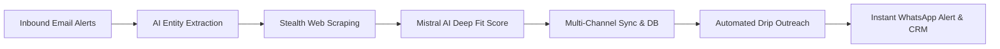
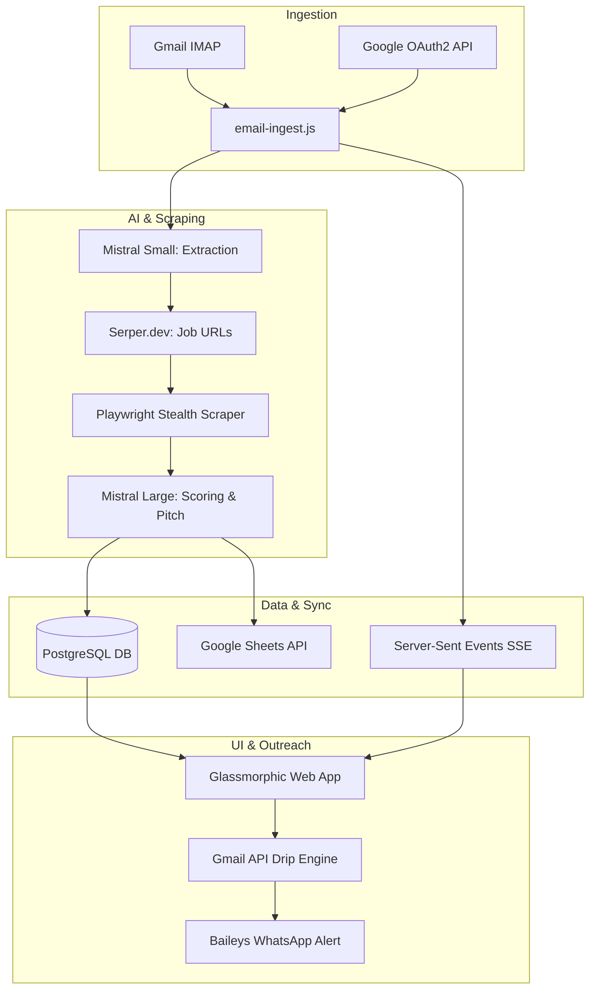

# 🚀 Revix CRM
## Autonomous Lead Intelligence & Revenue Execution Hub
### Transforming Hiring Signals into Closed Deals

---

## 📌 Executive Summary

Modern enterprise sales teams spend **40%+ of their time** manually searching job boards, qualifying company size, researching tech stacks, and drafting cold emails.

**Revix AI** automates the entire top-of-funnel lifecycle:
1. **Listens** to inbound job alerts & notifications via Gmail / IMAP.
2. **Extracts & Scrapes** real-time job specifications using Headless Playwright.
3. **Qualifies & Scores** prospects (0–100) using Mistral AI models.
4. **Executes Cold Outreach** with automated multi-day drip sequences.
5. **Detects Replies** and triggers instant alerts on WhatsApp & Email.
6. **Converts** qualified leads into Accounts, Deals, Tasks, & Quotations in 1-Click.

---

## 🛑 The Problem

| The Manual Way | The Pain |
| :--- | :--- |
| **Manual Inbox Sorting** | Thousands of irrelevant job alert emails sit unread. |
| **Superficial Qualification** | Reps cannot verify company size, R&D hiring signals, or ICP fit quickly. |
| **Slow Outreach** | Generic copy-pasted outreach templates get < 3% response rates. |
| **Scattered Data** | Disconnected tools: separate scrapers, sheets, CRM, and email clients. |
| **Missed Replies** | Inability to respond instantly when an interested prospect writes back. |

---

## 💡 The Solution: Revix CRM



- **Autonomous Pipeline**: Zero human effort needed to discover, filter, and score candidates.
- **Deep ICP Intelligence**: Analyzes R&D roadmaps, patent signals, employee counts, and hiring intent.
- **Unified CRM & Proposal Engine**: Move directly from qualified lead to commercial quotation.

---

## 🏗️ End-to-End System Architecture



---

## ⚡ The 7-Stage Intelligence Pipeline

1. **Email Polling**: Ingests raw alerts from whitelisted senders (LinkedIn, Naukri, Indeed).
2. **Mistral Small Extraction**: Parses job title, company name, and location in milliseconds.
3. **Serper Search**: Discovers live job posting URLs across major portals.
4. **Deduplication Engine**: Checks PostgreSQL cache and 7-day memory to prevent duplicate crawls.
5. **Playwright Chromium**: Extracts full job descriptions, tech stack details, and employee counts.
6. **Mistral Large Evaluation**: Computes 0–100 Fit Score, executive summary bio, and customized pitch.
7. **Real-Time Delivery**: Logs to PostgreSQL, appends to Google Sheet, and streams to UI via SSE.

---

## 🤖 Dual-Stage AI Model Architecture

### ⚡ Mistral Small (`mistral-small-latest`)
- **Role**: High-speed, cost-effective entity extraction.
- **Output**: Clean JSON parsing of unstructured emails.

### 🧠 Mistral Large (`mistral-large-latest`)
- **Role**: Deep ICP matching and enterprise value generation.
- **Output**:
  - **ICP Fit Score (0–100)**: Evaluates R&D signals, sector fit, and headcount.
  - **Executive Company Bio**: Overview of innovation strategy and market footprint.
  - **Personalized Cold Outreach**: Tailored pitch referencing specific job responsibilities.

---

## 📧 Cold Outreach & Drip Automation

```
[Day 0: Initial Outreach]
   │
   ├── (No Reply in 72h) ──> [Day 3: Value Add & Case Study]
   │                            │
   │                            └── (No Reply in 96h) ──> [Day 7: Final Inquiry / Breakup]
   │                                                         │
   └── (Reply Detected) ─────────────────────────────────────┴──> [Instant Notification]
         • Sequence Pauses
         • Lead Status -> "Replied"
         • WhatsApp & Email Alert Dispatched!
```

---

## 📱 Real-Time Alerts: Baileys WhatsApp & Brevo

### Instant Lead & Reply Notifications
- **WhatsApp Alerts**: Sends push messages directly to sales reps via **Baileys Gateway** (self-hosted multi-device socket, zero 3rd party fees).
- **Brevo Email Alerts**: Instant notifications for inbound client responses.
- **Zero Latency**: Never miss a hot lead or prospect inquiry.

```
┌──────────────────────────────────────────────┐
│ 🔔 REVIX CRM ALERT                          │
│ Prospect Replied: Sarah Jenkins (VP of R&D)  │
│ Company: Acme Advanced MedTech               │
│ Action: Deal created & moved to "Qualified"  │
└──────────────────────────────────────────────┘
```

---

## 💼 Full-Featured CRM Suite

* **🎯 Leads Explorer**: Filter by fit score, company headcount, sector, and hiring urgency.
* **📊 Deals Kanban**: Visual 6-stage sales pipeline (`Prospect` ➔ `Qualified` ➔ `Proposal` ➔ `Won`).
* **🏢 Accounts & Contacts**: Unified 360° company profiles with mapped stakeholder contacts.
* **📝 Commercial Quotations**: Dynamic proposal generator with automated tax and line-
item totals.
* **✅ Task Manager**: Integrated daily sales activities, reminders, and deal linkages.
* **📟 Live Terminal**: Real-time log streaming using Server-Sent Events (SSE).

---

## 🔒 Security & Role-Based Access Control

### 1. Multi-Factor Authentication
- **Brevo Email OTP**: 6-digit one-time password verification.
- **Google OAuth2 SSO**: Enterprise workspace sign-in.

### 2. Role Permissions (RBAC)
- **Team Leader (TL)**: Full system access, configuration controls, background cron triggers, and analytics.
- **Team Member (TM)**: Lead qualification, deal pipeline tracking, task updates, and quotation generation.

---

## 💻 Tech Stack Highlights

```
Frontend:   HTML5 | CSS3 (Modern Glassmorphic UI) | Vanilla JS | SSE Stream
Backend:    Node.js (v22+) | Express.js v5 | Playwright Chromium | Baileys Gateway
Database:   PostgreSQL (Local / Cloud) + Google Sheets API Sync
AI Models:  Groq AI (Llama 3.3 70B) | Google Gemini 2.0 Flash | Mistral AI
Alerts:     Baileys (WhatsApp Web Socket) | Brevo (Email OTP & Notifications)
```

- **Lightweight & High Performance**: Zero heavy frontend framework overhead.
- **Resilient Web Scraping**: User-agent rotation and anti-bot mitigation.
- **Enterprise-Ready**: Fully containerizable and scalable.

---

## 📈 Business Impact & ROI

| Metric | Before Revix | With Revix AI | Improvement |
| :--- | :--- | :--- | :--- |
| **Lead Discovery & Scoring** | 15–20 mins / lead | < 15 seconds / lead | **98% Faster** |
| **Daily Qualified Leads** | 10–15 leads | 100+ leads | **10x Volume** |
| **Response Rate to Outreach** | ~2–4% (generic copy) | 12–18% (AI tailored) | **4x Conversion** |
| **Time to First Outreach** | 24–48 hours | < 5 minutes | **Instant** |
| **CRM Data Entry Overhead** | 1–2 hours / day | 1-Click Automated | **100% Eliminated** |

---

## 🗺️ Product Roadmap

- [x] Autonomous Email Ingestion & Filtering (IMAP / Gmail API)
- [x] Dual-Stage Mistral AI Qualification Pipeline
- [x] Playwright Anti-Fingerprint Web Scraping
- [x] PostgreSQL CRM Suite (Accounts, Contacts, Deals, Tasks, Quotes)
- [x] WhatsApp & Brevo Real-Time Reply Alerts
- [ ] **Multi-Channel Outreach**: LinkedIn InMail automation
- [ ] **Voice AI Agent**: Inbound AI call screening for qualified leads
- [ ] **Predictive Win Scoring**: ML-based closing probability for Kanban deals

---

# 🚀 Thank You!

### **Revix CRM | Autonomous AI Lead Intelligence & Revenue Hub**
*Next-Generation Autonomous Enterprise Prospecting*

- 🌐 **Web Portal**: `http://localhost:3000`
- 📖 **Documentation**: [`project_guide/full.md`](project_guide/full.md)
- ⚡ **Quick Start**: `npm start`
