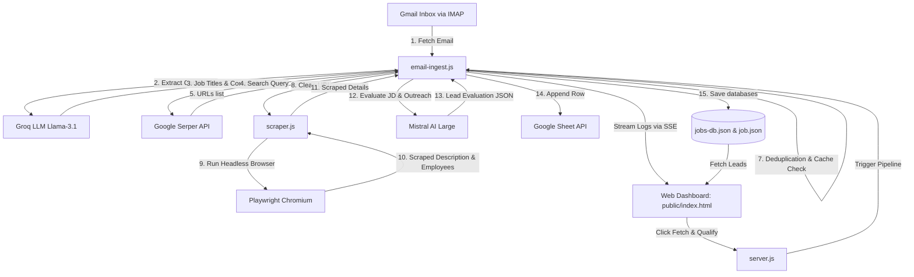

# R&D Lead Intelligence Portal

An automated, intelligent lead intelligence agent and pipeline. It crawls job alerts from a whitelisted Gmail inbox, qualifies candidates using whitelisted rules, extracts full job descriptions using headless Playwright browsers (supporting expired/closed job listings), scores leads using Mistral AI, logs qualified leads directly into a Google Sheet and local database, and displays them on a premium, light-themed glassmorphic web dashboard secured by Brevo OTP email authentication.

---

## 1. System Architecture



---

## 2. Directory & Key Files

*   **[server.js](server.js)**: The core Express application server. Serves the static dashboard, runs the OTP authorization system, acts as the API gateway, and broadcasts live logs using Server-Sent Events (SSE).
*   **[email-ingest.js](email-ingest.js)**: Orchestrates Gmail IMAP connection, Groq/Mistral evaluation stages, Serper searching, Playwright scraper calling, and Google Sheets updates.
*   **[scraper.js](scraper.js)**: Utilizes Playwright to automate search result parsing and scrape company details (supports scraping expired/closed job pages). Contains a 7-day memory cache to avoid redundant LinkedIn company calls.
*   **[public/login.html](public/login.html)**: A premium glassmorphic light-themed login page requiring authorized emails to enter a 6-digit OTP verification code.
*   **[public/index.html](public/index.html)**: Dashboard interface with a tabular qualified leads view, live terminal log stream, filter capabilities, search parameters, and a pipeline execution trigger with a "Last Run" indicator.
*   **[public/detail.html](public/detail.html)**: High-fidelity popup page showing specific lead evaluation scores, company overview bio, Wikipedia links, and a custom AI outreach message.
*   **[public/flow.html](public/flow.html)**: Interactive timeline outlining rules and steps enforced by each pipeline component.
*   **[jobs-db.json](jobs-db.json) / [job.json](job.json)**: Local JSON databases storingqualified candidates.
*   **[service-account.json](service-account.json)**: Google Cloud Service Account credentials key to access the Google Sheets API.

---

## 3. Setup & Installation

### Prerequisite
Make sure you have [Node.js](https://nodejs.org/) installed (v18+ recommended).

1. **Clone/Extract Project**: Navigate to the root folder of the project in your terminal.
2. **Install Dependencies**:
   ```bash
   npm install
   ```
3. **Configure Environment Variables**:
   Create a `.env` file in the root folder containing the following configurations:
   ```env
   # Google Sheets & Credentials
   GOOGLE_SPREADSHEET_ID=your_google_spreadsheet_id
   GOOGLE_SERVICE_ACCOUNT_KEY_PATH=service-account.json

   # Gmail IMAP Authentication
   GMAIL_USER_EMAIL=your_gmail@gmail.com
   GMAIL_APP_PASSWORD=xxxx xxxx xxxx xxxx
   ALLOWED_SENDERS=allowed_sender@gmail.com

   # LLM API Keys
   MISTRAL_API_KEY=your_mistral_api_key
   GROQ_API_KEY=your_groq_api_key
   SERPER_API_KEY=your_serper_api_key

   # Brevo Email SMTP (Axios OTP Login)
   BREVO_API_KEY=your_brevo_api_key
   BREVO_SENDER=your_sender@gmail.com

   # Pipeline Thresholds & Business Rules
   PORT=3000
   MIN_FIT_SCORE=50
   MIN_EMPLOYEES=500
   SECTOR_FILTER=Manufacturing, Automotive, Aerospace, Pharma, MedTech, Global Capability Centers (GCC)
   RD_SIGNALS=technology roadmap, R&D strategy, IP analyst, patent portfolio, innovation manager, TRIZ, NPD
   EXCLUDED_SECTORS=IT Services (TCS, Infosys, Wipro, etc.), Trading, Startups <5 years, Retail chains, Gig economy, Distributors, Law firms, Consulting firms, IP services, BPO, KPO, recruitment, staffing, outsourcing

   # Custom Prompt Templates
   GROQ_EXTRACT_PROMPT="Your custom Groq prompt here (with {{SECTOR_FILTER}}, {{EXCLUDED_SECTORS}}, {{EMAIL_BODY}} placeholders)"
   MISTRAL_EVALUATE_PROMPT="Your custom Mistral prompt here (with {{SECTOR_FILTER}}, {{MIN_EMPLOYEES}}, {{RD_SIGNALS}}, {{EXCLUDED_SECTORS}}, {{COMPANY}}, {{POSITION}}, {{LOCATION}}, {{JOB_URL}}, {{DESCRIPTION}} placeholders)"
   ```

4. **Verify Google Sheets Credentials**:
   Make sure you have placed the Google Service Account key file `service-account.json` in the root folder of the project, and share your target Google Sheet as "Editor" with the `client_email` listed in the JSON file.

---

## 4. Execution Scripts

- **Start Web Dashboard & Server**:
  ```bash
  npm start
  ```
  Open **`http://localhost:3000`** in your browser. You will be redirected to the secure OTP login screen. Enter an authorized email (listed in the whitelisted USERS configuration), copy the verification code from your email, and log in to open the dashboard.
  
- **Run Ingestion CLI directly**:
  To fetch emails and crawl leads without launching the dashboard:
  ```bash
  npm run ingest
  ```
  
- **Batch Testing CLI**:
  To manually search and qualify specific job descriptions for testing:
  ```bash
  node test.js "Job Title Company Location"
  ```
